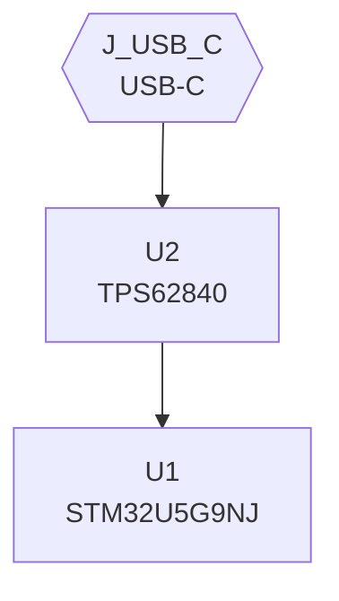

# BLPL user guide

Version: v1, 2026-10-29. Covers `main` as of commit `f79f664` (2026-10-24).

This guide is for a person who wants to **use** BLPL to get from a hardware idea to a board a fab can quote, in the web app or on the command line. It does not assume you have read the rest of `docs/`. Where a topic has a deeper page, this guide says what you need to know and links to it.

If you only read one section, read [The five rules that save the most time](#the-five-rules-that-save-the-most-time).

## Contents

1. [What BLPL is, in one page](#what-blpl-is-in-one-page)
2. [The five rules that save the most time](#the-five-rules-that-save-the-most-time)
3. [Vocabulary](#vocabulary)
4. [Getting access](#getting-access)
5. [First session in the web app](#first-session-in-the-web-app)
6. [A tour of the web app](#a-tour-of-the-web-app)
7. [Writing design markdown that the pipeline reads](#writing-design-markdown-that-the-pipeline-reads)
8. [project.yaml: everything that is not markdown](#projectyaml-everything-that-is-not-markdown)
9. [Running the pipeline](#running-the-pipeline)
10. [Reading the results](#reading-the-results)
11. [From a reviewed board to a fab order](#from-a-reviewed-board-to-a-fab-order)
12. [Working with the design chat](#working-with-the-design-chat)
13. [Multi-board projects](#multi-board-projects)
14. [Modules, the component library and references](#modules-the-component-library-and-references)
15. [Security and sharing, from the user's side](#security-and-sharing-from-the-users-side)
16. [The command line](#the-command-line)
17. [Troubleshooting](#troubleshooting)
18. [Message and code reference](#message-and-code-reference)
19. [Where to go next](#where-to-go-next)

---

## What BLPL is, in one page

BLPL (Board Layer Pipe Line) turns hardware design documents written in Markdown into KiCad projects: a schematic, a board, a project file, and a release package of gerbers, drill files, placement files and BOMs.

You write what you already would in a design doc: a block diagram, a BOM table, a pinout table per IC and connector, a table of how the passives connect. BLPL reads those tables, resolves each part to a KiCad symbol and footprint, builds the nets, places the parts, writes the KiCad files, routes the board if a router is available, checks it, and reviews it.

```
design markdown (*.md)  +  project.yaml (board size, stackup, net classes)
        │
        │  Preflight / blpl doctor: what would the pipeline silently lose?
        ▼
Stage 0  parse tables            → design_artifact.json
Stage 1  resolve parts (LLM)     → bom.json
Stage 2  library lookup          → coverage_report.json
Stage 3  fill gaps, pin maps     → gaps.md        (may stop and ask you)
Stage 4  build nets              → nets.json
Stage 5  manifest + placement    → hdm.yaml       (needs project.yaml)
Stage 6  write KiCad files       → .kicad_sch / .kicad_pcb / .kicad_pro, and kicad/
Stage 6a autoroute               → routed board, or a report saying why not
Stage 7  ERC / DRC / KLC         → validation_report.json
Stage 8  design review           → review.md
        │
        ▼
Release: fab gate, gerbers, drill, placement, BOMs per assembly house
```

Three properties shape how you work with it:

- **Text is the source of truth.** Your markdown, `project.yaml`, the manifest (`hdm.yaml`) and the KiCad files are all text and all live in git. You review a change to a board the way you review a change to code: as a diff.
- **Most of it is deterministic.** Only Stage 1 (and optionally Stage 0) uses a language model. Everything else is ordinary code that does exactly what the tables say. That is good news (the same input gives the same board) and a constraint: the pipeline cannot guess what you meant. A table in the wrong shape is not "interpreted generously"; it is dropped.
- **It tells you what it did not do.** Every stage reports what it skipped and why. A report that says "nothing verified" is not a pass. Learning to read those reasons is most of learning BLPL.

There are two ways to drive it:

- **The web app** (hosted, usually at `http://<host>:1800`): projects in git on the server, KiCad in the server image, a design chat, a board viewer, run history and the release builder. Most users should start here.
- **The `blpl` command line**: the same pipeline on your own machine. Useful for scripting, CI and debugging a single stage.

---

## The five rules that save the most time

1. **Run Preflight (`blpl doctor`) before anything else, every time you edit the markdown.** Stage 0 silently discards any table it cannot classify. Preflight tells you what would vanish before you spend a run on it. Fix every error; read every warning.
2. **Every pinout heading must contain the part's refdes, starting with `U` or `J`.** `## U1 pinout` and `## Connector J_USB_C, USB-C receptacle` work. `## USB-C pinout` anchors to nothing and its pins disappear from the board.
3. **Signal names are net names.** Two pins anywhere on the board with the same signal name are joined. Great for `GND` and `VCC_3V3`; a short circuit for `Reserved`, `RESET` or `P0.00` on two different chips. Qualify them (`BLE_RESET`, `CELL_RESET`) and write open pins as `NC_<ref>_<pin>` or plain `NC`.
4. **Never put a placeholder in a table cell, including `TBD`.** A `TBD` footprint becomes a silent placeholder footprint; a `TBD` trace width becomes the default width. If a value is unknown, leave the row out and note in prose that the design is not ready.
5. **Board size, stackup and net-class values live in `project.yaml`, not in markdown.** A net-class table in your doc is reference only. Use the Board tab in the app, or `blpl init`, to create `project.yaml` from what your markdown already says.

---

## Vocabulary

| Term | Meaning |
|---|---|
| **Project** | A git repository holding one product's design: its markdown, `project.yaml`, generated `kicad/` folder, and `.pipeline/` build output. |
| **Board** | One PCB. A simple project is one board. A multi-board project declares its boards in `project.md`. |
| **Design markdown** | The `*.md` files at the project root (or in each board's folder) that the pipeline reads. Prose is for people; only tables are parsed. |
| **Refdes** | Reference designator: `U1`, `J_USB_C`, `R8`. The anchor for every table. |
| **BOM table** | A table with `Ref`, `MPN` and `Package` columns. One row per physical part. |
| **Pinout table** | A table with `Pin` and `Signal` columns under a heading that names a `U` or `J` refdes. |
| **Connections table** | A table keyed by `Ref` that wires parts with no pinout table (passives, diodes, transistors). |
| **GPIO map** | A `GPIO / Signal / Destination` table under a heading naming the host IC; re-homes MCU pins onto named nets. |
| **pin_map** | For one part: which symbol pin number carries which signal. Generic parts get one automatically; specific ICs need one from you. |
| **Net class** | A named set of trace width, clearance and via sizes (`Default`, `Power_Bulk`, `USB2_Diff_90Ohm`). Nets land in classes by name pattern. |
| **HDM / `hdm.yaml`** | Hardware Description Manifest. The single YAML file describing the whole board after Stage 5; Stage 6 writes exactly what it says. Readable and editable. |
| **`.pipeline/`** | The build directory. Every stage's output. Gitignored. |
| **`kicad/`** | The tracked copy of the latest emitted board, at fixed file names, with its own libraries. Opens in a stock KiCad. This is the folder you share. |
| **Provenance** | Stage 8's label on each finding: `emitter` (BLPL's bug), `design` (a problem in your design) or `expected` (something did not run, and why). |
| **Placeholder** | A generic stand-in symbol or footprint for a part BLPL could not resolve. The board opens and looks fine; it is wrong. Placeholders block release. |
| **Proposal** | How the design chat edits files: a diff you accept or reject. The chat never writes a file directly. |
| **Module** | A proven circuit block lifted off a finished board, reusable on a new one. Its cut nets become its ports. |
| **Release package** | The zip a contract fab quotes from: gerbers, drill, placement, BOMs, the KiCad project, checksums, and the gate's verdict. |
| **Endpoint** | A named model connection (Anthropic, OpenAI, OpenAI-compatible, Ollama) that tasks such as chat, Stage 1 or the review panel are routed to. |

---

## Getting access

You need four things before you start:

1. **The address**, usually `http://<host>:1800` (or `https://<host>:1443`).
2. **An account.** Sign-in is Clerk: sign up with your email, or use the invitation link you were sent. An invitation link works once and expires after 24 hours; sign up with the same address it was sent to.
3. **An empty git repository and an access token** for each new project (GitHub, GitLab, Gitea, Forgejo or Codeberg). Importing files needs neither.
4. **A model to use.** Either your own API key (Anthropic, OpenAI or an OpenAI-compatible service) or the address of a local model server (Ollama, or an OpenAI-compatible server that needs no key). There is no shared server key.

If the page says "The server is not answering", the backend is down or still starting; that is not a sign-in problem and the page retries by itself. If you can sign in but then see "this server rejected the session", the server's configuration is wrong; tell the operator.

---

## First session in the web app

### 1. Set up your account (once)

After the first sign-in you see **"Two things before you start"**, then **Set up your account**. Everything on that page is required:

- **Passphrase** (at least 10 characters, typed twice). This is not your sign-in password. It derives the key that encrypts your API keys and git credentials. **The server keeps no copy and cannot reset it.** Write it down somewhere safe, and add a passkey as a second way in (see below). **If you forget it and have no passkey, there is no recovery.** The same key also holds the private key that opens your encrypted projects, so you lose your provider keys, your git credentials and your access to every project at once, and the account cannot be set up again with a new passphrase. What survives is what was pushed to a git remote, which can be cloned again, and projects another member can still open.
- **Provider, model, API key, base URL.** Pick the provider, paste the key (or the base URL of a local server), and choose a model from the suggestions. A "Need a key?" link takes you to the provider's sign-up page.

Press **Finish setup**.

### 2. Unlock (after every server restart)

When the server restarts, your data is locked again and you see **Unlock your data**. Type the passphrase, or press **Unlock with a passkey**. Being signed in to Clerk and being unlocked are two different things: Clerk says who you are, the passphrase opens what only you can read. If this happens mid-session, the unlock screen appears on top of your work and nothing unsaved is lost.

Tip: add a passkey (Touch ID, Windows Hello, or a recent security key) under **Settings > Data security** so you do not have to type the passphrase each time. A passkey is a second door to the same key; removing one never locks you out of your data.

### 3. Create or open a project

From the dashboard, press **+ Project**. Three ways in:

| Mode | Use it when |
|---|---|
| **New** | Starting a design. **Requires an empty remote repository**: create one first (on GitHub, GitLab, Gitea, Forgejo or Codeberg), then give its URL and an access token. **Test connection** checks both before anything is created. "How do I set this up?" explains the tokens for each host. |
| **Clone git remote** | The design already lives in git. Give the clone URL and branch. |
| **Import files** | You have markdown (or a .zip of a project) on your machine. No remote is needed; you can add one later under Project settings > Git. |

For New and Clone you also set:

- **Commit name and email** for this project ("Also use as my default" saves it for every project). Commits are refused until an identity is set.
- **Push policy**: push automatically after every commit (recommended), or push manually. Manual means commits stay only on the server until you push.
- **Library policy**: whether this project may contribute parts to your shared component library, and whether it may use parts from it without asking.

### 4. Write or import the design, then run Preflight

Open the **Preflight** tab. It reads your markdown and reports what the pipeline would lose. "Nothing blocking" plus "No findings" means the markdown parses exactly as written.

### 5. Set the board up

Open **Project settings** (the wrench next to the project name) > **Board**. Set the outline, stackup and net classes, and press **Save board config**. This writes `project.yaml`. The page predicts which `ZC-*` impedance findings Stage 8 will report, before you run anything.

### 6. Run the pipeline

In the left rail open **Pipeline**, choose **Pipeline**, from `stage0` to `stage8`, and press **Run pipeline**. Watch the progress bar and log. Then open **Board** to see the result and **Reports** to read the review.

---

## A tour of the web app

### The layout

On a wide screen the workspace has three panes:

```
┌────────────┬──────────────────────────────────────┬────────────┐
│  Rail      │  Viewer tabs                         │  Chat      │
│  Boards    │  Board | Preflight | View/Edit | BOM │            │
│  Files     │  Lifecycle | Modules | Reports       │            │
│  Pipeline  │  Release | Artifacts | Changes       │            │
│  Runs      │                                      │            │
└────────────┴──────────────────────────────────────┴────────────┘
```

- Drag the borders between panes to resize them; double-click a border to reset it. `«` / `»` collapses the rail. The chat icon in the header shows or hides the chat. These choices are remembered in your browser.
- Tabs that do not fit fold into **More ▾**.
- Above every tab, **Ask chat agent about this** puts a reference to what you are looking at into the chat box (it never sends by itself).
- On a phone the app shows one pane at a time behind four bottom tabs: **Files**, **View**, **Chat**, **More**. Opening a file jumps to View; "Ask chat" jumps to Chat. Settings, sharing, new project and the KiCad link live under More.

### Header

| Control | What it does |
|---|---|
| `←` and logo | Back to all projects (asks first if you have unsaved edits). |
| Project picker | Switch project. A `⚠` marks a project with a problem. |
| Wrench | **Project settings**: Board, Task routing, Git, Library policy, Auto-lock. |
| Active board (multi-board projects) | The board every tab and run is about. Next to it: **fabricable**, or **not fabricable** with the count of placeholder parts and emitter defects. |
| **Open KiCad in New Tab** | A full KiCad desktop running on the server, for drawing a symbol or footprint the libraries do not have. It opens the current board. |
| New project, Chat, Share, Settings | As named. On narrower screens they fold into `⋯`. |
| Your avatar | Account menu and sign-out. |

### The git strip

Under the header, a strip shows the project's git state:

| Badge | Meaning |
|---|---|
| `⎇ main` | Current branch. |
| **uncommitted changes** | Files changed since the last commit, usually pipeline outputs or a dropped-in datasheet. (Editor saves and accepted chat edits commit themselves.) |
| **N commits not pushed** | Saved on the server only. Pushing keeps a copy off the server. |
| **N to pull** | Someone pushed to the remote. |
| **no commit identity** | Commits are refused until you set a name and email (Project settings > Git, or Settings > Commit identity). |
| **local only** | No remote. History lives on this server only. |
| **push failed**, **remote needs fixing** | Hover for the reason. |

**Pull** and **Commit + Push** do what they say; Commit asks for a message.

### Rail: Files

Files are grouped: Design, Diagrams, KiCad, Datasheets, References, Pipeline, Notes, Other, Quarantine.

- **+ File** creates a `.md`, `.yaml` or `.yml` file (the types the workbench edits). **+ Folder** creates a folder. **+ Upload** opens the upload dialog.
- Type in **Filter…** to search. **Show hidden** reveals dotfiles.
- Keyboard: Enter opens, F2 renames, Delete deletes, arrows move, typing jumps. Drag to move. Right-click for Open, New file here, New folder here, Rename, Delete, and (on a symbol library) Remove a symbol.
- Deleting asks first, and says whether the file is in git history (recoverable) or not (permanent).
- A KiCad file opens in the KiCad tab, a PDF in the PDF viewer, text in View/Edit, anything else downloads.
- The **LLM ignore** badge marks files the assistant will not read.

**Upload** takes up to 20 files at a time. For each, choose a kind:

| Kind | Lands in | Notes |
|---|---|---|
| Datasheet | `datasheets/` | Optionally give the MPN; the file is named after it. |
| Reference | `references/` | |
| KiCad symbol (`.kicad_sym`), footprint (`.kicad_mod`), 3D model (`.step`, `.wrl`), library bundle (`.zip`) | `libraries/` | Give the library name it belongs in. |

PDFs are inspected before the browser will open them. A file that fails inspection is **held** in `retrieved/` (quarantine) rather than added.

### Rail: Pipeline

Three modes:

- **Single stage**: pick one of `doctor`, `init`, `stage0-det` ... `stage8`, `stage6a`, and press **Run**.
- **Pipeline**: pick **from** and **to**, and on a multi-board project the scope (one board, or all boards then the cross-board check). Press **Run pipeline**.
- **Review panel**: run every reviewer routed to `review_panel` over the current board.

While a run is going you see the current stage, what it does (tick **Explain the active stage** for more), a progress bar, and each stage as waiting, running, done, skipped, or with errors. **Stop** stops it. Runs are durable: closing the tab does not stop a run, and you can come back to it from Runs on any machine. Only one run per project at a time.

The log has three levels: **Milestones** (stage headers, results, anything wrong), **Normal** (plus each stage's output), **Everything** (plus indented detail). It follows the end while you are scrolled to the bottom.

A failed run offers **Ask chat agent about this run**.

### Rail: Runs

Every run, newest first, with board, start time, duration and status (`running`, `ok`, `stopped`, `exit N`). Click a row to replay its log; a running row follows live and can be stopped.

### Viewer tabs

| Tab | Shows | Key actions |
|---|---|---|
| **Board** | The emitted board (schematic, PCB and 3D) in the built-in viewer. Chat replies that name a part or net highlight it. | If Stage 6 has no current output, an archived board is shown with a banner. |
| **Preflight** | The doctor report: what Stage 0 sees (tables used, tables discarded), findings grouped by code with file, line and fix. On multi-board projects, also "Where the boards meet". | Fix each error in the markdown, then check the tab again. |
| **KiCad** | A `.kicad_sch` or `.kicad_pcb` you opened from the file tree. | **Open the raw file**. |
| **View/Edit** | Text files rendered (Markdown with math and diagrams, JSON, YAML, code). | **Source** shows line numbers, matching what doctor cites. **Edit** and **Save** (Ctrl/⌘+S) for design documents (`.md`, `.yaml`, `.mmd`). Others are read-only. |
| **BOM** | `bom.json`: Ref, MPN, manufacturer, package, pins, symbol and footprint hints, Stage 1 confidence. | Filter. **Export BOM to CSV** (every part). **Export BOM for purchasing / quotes** for N **Boards** (MPN, MFG, QTY, attrition, order quantity; bought parts only). |
| **Lifecycle** | Each part's lifecycle status from distributor data, and your own finding. | **edit** a row: what you found, when, a reference someone else can check, notes. **Acknowledge** accepts a part whose lifecycle could not be established. A finding without a reference is not counted. |
| **Modules** | Modules available to this project, with their ports. | Ask the chat to read a KiCad design and plan an extraction. |
| **Reports** | Fab banner, Stage 7 pills (KLC, ERC, DRC, coverage), simulation, Stage 8 findings by provenance, and the review panel. | Expand a design-issue group to read it. |
| **Release** | The release builder and the latest package. | **Build release package**, **Look up LCSC part numbers**, **Download latest.zip**. |
| **Artifacts** | Every file in `.pipeline/`, with a readable view for the main ones (design artifact, nets with a filter, coverage). | Files over 1.5 MB open raw. |
| **Changes** | Everything changed since the last commit, as diffs. | Click a file to expand it. |

Mermaid diagrams (in files and in chat) can be panned by dragging and zoomed with Ctrl/⌘ + scroll, `−`, `+` and **Fit**.

### Chat

- **Model picker**: which endpoint answers this turn ("routed" uses your task routing). Not saved.
- **Session ▾**: switch conversation, start a **New session**, show archived ones, archive this one (kept, not deleted), and set message order.
- **Composer**: Enter sends, Shift+Enter is a new line. Paste, drop or use **+** to attach PNG, JPEG, GIF, WebP images or PDFs. Drag the grip above the box to resize it.
- **Slash commands** (type `/` in an empty box): `/files`, `/read`, `/artifact`, `/fab`, `/sourcing`, `/modules`, `/part`, `/datasheet`, `/review`. Each inserts editable text; nothing sends until you press Send.
- **While an answer is streaming**: keep typing and press **Queue**; queued messages send one per answer when it finishes cleanly. If the answer fails or you stop it, the queue is held with the reason, and you choose **Send now** or **Discard**. **Stop** cancels the answer.
- **Approval cards**: **Allow** or **Deny** a tool call (network access, spending money, changing a board).
- **Proposal cards**: a diff with **Accept** or **Reject**. Accepting writes and commits the file.
- **Lost answers**: if the provider was busy or an answer was lost, a banner offers **Ask again**. A message that was never answered is marked and not sent with later messages; you can remove it.
- Long conversations are summarised to fit the model's context; the files and git history are untouched.

### Project settings (wrench)

| Tab | What you set |
|---|---|
| **Board** | Outline (rectangle, circle, polygon, trapezoid) with a live preview, cutouts and keepouts (optionally following a part), stackup, net classes with optional controlled impedance, impedance tags, test points on controlled nets. Saves `project.yaml`; re-run Stage 5 afterwards. |
| **Task routing** | Per-project overrides of which endpoint handles chat, stage0, stage1, vision and the review panel. |
| **Git** | Remote, your token for its host, commit identity, push policy. |
| **Library policy** | Contribute to and consume from your component library. |
| **Auto-lock** | Minutes idle before the project is sealed (5 to 1440). |

### Account and app settings (cog)

| Tab | What you set |
|---|---|
| **AI model providers/endpoints** | Add named endpoints (kind, model, key or base URL, whether it reads images). **list models** asks the endpoint what it offers. Capability chips show what each model can do (vision, tools, thinking). |
| **Task routing** | Your default endpoint order per task. The first is tried first; later ones are fallbacks. `review_panel` runs all of them. A task that needs vision skips endpoints that cannot see. |
| **Git endpoints/accounts** | Saved tokens or SSH keys per git host, with presets for GitHub, GitLab and others. |
| **Commit identity** | Your default commit name and email. |
| **Data security** | Passkeys: add one per device, remove with `×`. |
| **Admin: Network access** | (Administrators only.) Which hosts pipeline runs may reach. |

### Sharing

**Share** (header) lists who can open the project. The owner can invite by sign-in email; someone without an account gets a one-time link valid for 24 hours, sent only after you type the address twice. Pending invitations can be withdrawn and members removed. Invitations to you appear on the dashboard and in a banner, with **Accept** and **Decline**.

---

## Writing design markdown that the pipeline reads

The pipeline reads tables, not prose. This section is the contract. The same rules are in `core/blpl/skills/hardware-design/SKILL.md`, which the design chat follows.

### Start from this template

```markdown
# <Board name>

A paragraph on what the board is for. No stage reads prose; it is for people.

## Block diagram

(a ```mermaid flowchart, see below)

## BOM

| Ref | MPN | Manufacturer | Package | Pin Count | Role | Notes |
|-----|-----|--------------|---------|-----------|------|-------|
| U1 | STM32U5G9NJH6Q | STMicroelectronics | Package_BGA:TFBGA-216_13x13mm_Layout15x15_P0.8mm | 216 | Main MCU | |
| J_USB_C | 12401548E4-2A | Amphenol | Connector_USB:USB_C_Receptacle_Amphenol_12401548E4-2A | 24 | USB-C power and data | |
| R8 | RC0402FR-074K7L | Yageo | Resistor_SMD:R_0402_1005Metric | 2 | I2C pull-up, 4.7k | |

## U1 pinout

| Pin | Signal | Function |
|-----|--------|----------|
| A1 | VDDIO | power |
| ... every pin, one row each ... |

## Connector J_USB_C, USB-C receptacle

| Pin | Signal | Function | Voltage |
|-----|--------|----------|---------|
| A1 | GND | ground | 0V |

## Connections

| Ref | Pin 1 | Pin 2 | Purpose |
|-----|-------|-------|---------|
| R8 | I2C_SDA | VCC_3V3 | I2C pull-up, at U1 |
| C6 | VCC_3V3 | GND | U1 decoupling, at U1 pin 23 |
```

### BOM table

- Required columns: `Ref`, `MPN`, `Package`. Optional but helpful: `Manufacturer`, `Pin Count`, `Role`, `Notes`. Column names are case-insensitive.
- **One row per part that exists.** A part named only in a diagram or a summary table does not reach the board. A grouped row such as `C1, C2, C3` or `R1-R6` becomes one part per reference.
- **Package is a full KiCad library name** (`Library:Footprint`), never abbreviated and never `TBD`. Ask the chat's `suggest_footprint`, or check `kicad-footprints/<Library>.pretty/`. A package value that matches several footprints (`SOIC-8`) is a decision for you, not for BLPL. A vendor module with no stock footprint needs one drawn in the project's `libraries/footprints/`.

### Pinout tables

- One per IC or connector. Required columns: `Pin`, `Signal`. `Function` and `Voltage` help net classification.
- The heading must contain the refdes token (`U1`, `J2`, `J_USB_C`, `U_GNSS`) anywhere in it. Only `U` and `J` refdes anchor. Parts like `SPKR1` or `SW1` are wired through the Connections table instead.
- **Every pin gets its own row.** No `1-5` ranges, no `...` rows, no "remaining pins omitted". A 216-ball BGA gets 216 rows. Let the chat's `pinout_section` render the table from the extracted datasheet rather than typing it.
- A heading with no refdes does not lose the table, but its pins go to a placeholder part `UNKNOWN_n` with a `STAGE0-001` warning.

### Connections table

Every part without a pinout table (resistors, capacitors, inductors, ferrites, diodes, small transistors) must be wired here, or Stage 4 stops with `STAGE4-007` naming each unconnected part.

- Two-pin form: `| Ref | Pin 1 | Pin 2 | Purpose |`. Multi-pin form: `| Ref | Pin | Net |`, one row per pin.
- One part per row (`R8, R9` in one row is refused, `STAGE0-008`).
- Pin numbers follow the KiCad symbol: `Device:D` and Zener/Schottky variants are 1 = cathode, 2 = anode; `Device:LED` is 1 = cathode; `Device:C_Polarized` is 1 = +. A reversed diode is invisible to ERC.
- A series part splits a net: keep the driving side's name and suffix the far side (`SPI_SCK` to `SPI_SCK_R`), and update the far part's pinout row to match.
- Name the part a passive serves in `Purpose` ("U3 decoupling, at U3 pin 8"). Placement puts it next to that part and the schematic draws it in that part's block.
- If a Connections row and a pinout table disagree about a pin, Stage 0 fails with `STAGE0-007`. Fix whichever is wrong.

### Naming rules that change the board

| Rule | Why |
|---|---|
| Qualify any signal that is not truly shared: `BLE_P0.00`, `CELL_P0.00`, `LORA_SPI_MOSI`. | Same name, same net. Unqualified names short unrelated pins. |
| Open pins: `NC`, `DNC`, `-`, or per-pin `NC_J2_17`. Never `Reserved` on several pins. | `NC` forms are dropped and get no-connect flags; `Reserved` repeated becomes one big net. |
| Differential pairs end `_P`/`_N` (`USB3_TX_P`, `USB3_TX_N`). | The net-class rules key off the suffix. |
| Power rails: `GND`, `VBUS`, `VCC_3V3`, `VCC_1V8`, `3V3`, `1.5V`. Not `3.3V RAIL`. | Rails are classified into `Power_Bulk` by pattern. |
| Named connectors get named refdes: `J_USB_C`, `J_HALOW`, not `J4`. | Easier to anchor, easier to read in reviews. |

### Block diagrams

Draw the architecture as a Mermaid `flowchart TB` (or `LR`) in a fenced code block tagged `mermaid`, or as a separate `*.mmd` file. The app renders it in place with BLPL's own palette. Tag nodes with a class and do not write `classDef` or theme lines; the app adds them.



Useful classes: `board`, `subboard`, `mcu`, `logic`, `rf`, `power`, `battery`, `memory`, `storage`, `connector`, `antenna`, `rfpassive`, `sensor`, `display`, `audio`, `haptic`, `passive`, `note`. Name nodes after the refdes the BOM uses so the diagram can be checked against the tables. Diagrams are not parsed into the netlist; they are how you and the chat agree on the structure before the tables are written.

---

## project.yaml: everything that is not markdown

`project.yaml` holds the board's physical and electrical settings. It is validated against `core/schemas/project_config.v1.json` when Stage 5 loads it, and an invalid file is refused rather than partly used. Create it with the app's **Board** tab or with `blpl init --project-dir <proj>`, which reads the identity, stackup and net-class tables already in your markdown. On a multi-board project each board has its own (`<board>/project.yaml`).

### The minimum

```yaml
project:
  name: USBC_Tap
  board_id: UT-1
  dimensions: [40, 30]          # mm, width and height; must equal the outline's bounding box
  stackup:
    layers: 2                   # 1, 2, 4, 6, 8 ...; odd counts are refused
    thickness: 1.6
    finish: ENIG

net_classes:
  Default:                      # must exist
    trace_width: 0.2
    clearance: 0.15
    via_dia: 0.6
    via_drill: 0.3
  Power_Bulk:
    trace_width: 0.6
    clearance: 0.2
    via_dia: 0.8
    via_drill: 0.4

boundaries:
  board_outline:
    shape: rect                 # rect | circle | polygon | trapezoid
    size: [40, 30]
    corner_radius: 2
```

### Every section at a glance

| Section | What it controls | Notes |
|---|---|---|
| `project` | Name, board ID, dimensions, stackup (`layers`, `thickness`, `finish`, optional `prepreg`, `core`, `er`). | Prepreg and dielectric constant set outer-layer impedance; take them from the fab's stackup. |
| `net_classes` | Width, clearance, via size per class; optional `impedance`, `diff_pair_gap`, `coplanar_gap`. | `Default` is mandatory. |
| `net_class_rules` | Name patterns that override Stage 4's guess. First match wins. | Use when a net lands in the wrong class. |
| `controlled_impedance` | Which nets need controlled impedance and at what target. | Regex over net names. 50 ohm single-ended by default. See below. |
| `boundaries.board_outline` | The board edge. | `rect` (size, corner_radius), `circle` (diameter), `polygon` (points), `trapezoid` (bottom, top, height). |
| `boundaries.cutouts` | Holes and slots inside the outline. | A notch in the edge belongs in the polygon instead. |
| `boundaries.keepouts` | Rule areas: what is forbidden where, on which layers. | Can be `anchor`ed to a part so it follows placement (antenna keepouts). |
| `boundaries.copper_zones` | Copper planes. | A list of `{net, layer}`; `none`; or `auto` (on 4+ layers: GND on In1.Cu, busiest supply on In2.Cu). |
| `placement.hints` | Per-part `x`, `y`, `rot`, `side`, `near`, `edge`. | Only those keys; anything else is refused. `x` and `y` go together. A hint is obeyed before automatic placement. |
| `placement.edge_margin` | Courtyard distance from the board edge, mm (default 1.0). | |
| `test_points` | `policy: none / power / all`, symbol, footprint, include and exclude lists. | Default `power`: one per power and ground net. |
| `assembly.dnp` | Footprint on the board, part not fitted. | Out of the BOM and placement file. |
| `assembly.footprint_only` | Copper only, nothing bought (Tag-Connect pads, test pads). | |
| `assembly.hand_fit` | Bought, but fitted by hand after assembly. | Stays in the BOM and purchase export; left out of the assembly houses' BOM and placement. Use for parts the house does not stock. |
| `assembly.attrition` | Extra parts to order per MPN for assembly losses. | Number = percent; or `{percent, min_extra}`. |
| `silkscreen.references` | `fit` (default) or `hidden`. | Hidden references stay on F.Fab. |
| `silkscreen.labels` | Readable labels by part (`{BT_POS: '+'}`). | |
| `silkscreen.marking` | The board's name and revision text, and where. | Fabs' release checks look for it. |
| `routing.router` | `kicad-routing-tools` (default when installed) or `freerouting`. | |
| `review.accept` | Findings that are true and intended, each with a reason. | Moves them to an accepted list; never hides them. |

### Placement hints

```yaml
placement:
  hints:
    C12: {near: U1}                  # decouples U1, whatever the netlist implies
    J3:  {x: 4.0, y: 22.5, rot: 90}  # x and y together
    U7:  {side: bottom}
    U3:  {edge: top}
```

Coordinates are board millimetres, origin top-left, y pointing down. A part the placer cannot fit is left unplaced and named in `hdm.yaml` (`synthesis.placement`) instead of being squeezed in.

### Controlled impedance

```yaml
net_classes:
  RF_50Ohm:
    trace_width: 0.35          # from the fab's impedance calculator, for this stackup
    clearance: 0.2
    impedance: 50
  USB2_Diff_90Ohm:
    trace_width: 0.18
    diff_pair_gap: 0.15
    clearance: 0.15
    impedance: {ohms: 90, mode: differential}
controlled_impedance:
  - nets: "_RF_(IN|OUT)$|^ANT_"
  - nets: "_USB\\d*_D[PMN]$"
    ohms: 90
    mode: differential
```

Never invent a width: it comes from the fab's calculator for the stackup you will order. If no class matches a target, Stage 5 creates one with Default geometry so the board still builds, and Stage 8 reports `ZC-001` until you declare a real width. The release package is not quotable while any `ZC-*` error stands, and the release also measures the routed copper (width, layer, pair coupling, reference plane). The `ZC-*` codes are listed in [pipeline-stages.md](pipeline-stages.md#controlled-impedance).

---

## Running the pipeline

### The normal loop

1. Edit the markdown (yourself, or by accepting a chat proposal).
2. **Preflight.** Fix errors; decide on each warning.
3. Run **Stage 0 to Stage 4** and read what Stage 3 asks for in `gaps.md`. Resolve any specific IC that has no pin map.
4. Make sure `project.yaml` exists and says what you mean (Board tab).
5. Run **Stage 5 to Stage 8**, or the whole range at once once the inputs are settled.
6. Read `review.md` (the Reports tab). Fix design findings in the markdown or `project.yaml`, accept intended ones with a reason, report emitter findings as BLPL bugs.
7. Repeat until Stage 8 is clean of emitter defects and placeholders and the design findings are triaged. Then build a release.

Stages are idempotent: re-running one with the same inputs gives the same output. To narrow a problem, run one stage and inspect its artifact rather than re-running everything.

### When Stage 3 stops and asks

Stage 3 auto-resolves passives, generic connectors (USB, barrel, FFC, M.2, headers) and three-pin transistors. Anything specific (MCU, FPGA, PMIC, radio, custom IC) needs a pin map from you, and `gaps.md` names each one with the exact command. Two ways to give it:

- Point at a KiCad symbol whose pins match: `blpl resolve-pin-map --project-dir <proj> --local-id U1 --lib-symbol Regulator_Linear:AP2127K`.
- Give the datasheet pinout as a two-column CSV (`signal,pin`): `blpl resolve-pin-map --project-dir <proj> --local-id U1 --csv u1_pinout.csv`. Add `--dry-run` to preview.

Better still, put a full pinout table for the part in the markdown; then Stage 3 has nothing to ask.

### What needs a model, and what does not

| Step | Model? |
|---|---|
| Preflight, Stages 2 to 8, release | No. Deterministic. |
| Stage 0 | No by default (`det`). `llm` mode and `both` (compare) are optional. |
| Stage 1 | Yes. Resolves each BOM row to MPN, package, symbol and footprint hints. |
| Design chat, datasheet extraction, review panel | Yes. Routed per task to your endpoints. |

In the app, keys are per user (Settings). On the command line, keys come from your environment (`ANTHROPIC_API_KEY`, `OPENAI_API_KEY`, `OLLAMA_HOST`).

### Optional tools and what happens without them

Missing tools never fail silently; they produce a named skip.

| Tool | Used by | Without it |
|---|---|---|
| KiCad 10 (`kicad-cli`, `pcbnew`) | Stage 6 plugin path, Stage 7, autoroute, release | Stage 6 uses the built-in emitter; Stage 7 checks are skipped with a reason. The hosted app always has it. |
| Router (KiCad Routing Tools or Freerouting + Java) | Stage 6a | Board ships unrouted; `autoroute_report.json` says why; Stage 8 excuses unrouted nets as `expected`. |
| ngspice | Stage 8 simulation, `blpl spice` | Simulation reports `skipped`. LTspice and Xyce run but return no measurements. |
| Distributor credentials (DigiKey, Mouser, element14) | Lifecycle audit, parts search | Lifecycle audit is skipped (`LC-007`, expected). |
| Network access to LCSC | JLCPCB BOM's LCSC part numbers | The JLCPCB BOM uploads but cannot be built; the release says so. |

---

## Reading the results

### Preflight (doctor)

Seventeen checks, `DOC-000` to `DOC-016`. Errors mean data will be lost or misread; warnings mean a later stage will stop or guess. The full list is in [Message and code reference](#message-and-code-reference). Preflight only reads; it never changes a file.

### Stage 7: is it a legal KiCad project?

ERC on the schematic, DRC on the board, KLC on any symbol BLPL generated, and library coverage. On an unrouted board, expect unrouted-net DRC entries. They are not a pipeline bug.

### Stage 8: is it a good board, and did BLPL emit what you asked for?

Read `review.md`, or the Reports tab. Every finding carries a provenance:

| Provenance | Meaning | What you do |
|---|---|---|
| `emitter` | BLPL lost or mangled something you gave it. | Report it. These gate the release. Do not "fix" the board by hand. |
| `design` | A real electrical issue in your design. | Fix it in the markdown or `project.yaml`, or accept it in `review.accept` with a reason. |
| `expected` | Something did not run this time; the line says why. | Enable the missing tool if you need that check. |

Stage 8 also cross-checks things the analyzers cannot see: parts lost between Stage 0 and Stage 1, BOM rows missing from the emitted schematic or board, footprints under an unassigned reference (`REF**`), and **placeholder parts**, which block fabrication at any severity.

`ok: false` means emitter defects or placeholders exist. Design issues never gate on their own; they are yours to triage.

### Simulation: four outcomes, only one is verification

| Outcome | Meaning |
|---|---|
| skipped | No simulator installed. |
| nothing to simulate | No testbench was built (for example, a crystal drawn without load caps: a design gap). |
| nothing measured | Testbenches ran, no numbers came back (normal for LTspice). |
| measured | Real pass, warn and fail counts. On an unrouted board, parasitics are not included. |

The fab banner on the Reports tab is computed from placeholders and emitter defects only. It can say "no blockers" on a board whose analog side nobody has simulated.

### The review panel

If several endpoints are routed to `review_panel`, each reviews the same evidence pack and the findings are merged with attribution. Agreement ranks a finding; it never suppresses one. A finding raised by only one reviewer is kept and labelled single-source, and it is often the one the others missed.

---

## From a reviewed board to a fab order

### Release package

The Release tab (or `python -m blpl.core.release`) builds one zip per board with gerbers for every copper layer, drill files, placement, a BOM grouped by part, the native KiCad project, `fab/impedance.md` when nets are controlled, and a checksum for every file.

The **fab release gate** runs first. A gate that could not run is reported as unknown, never as a pass. A board the gate refuses still gets a package, with `READ-ME-FIRST.txt` inside the zip, because the zip is what gets emailed and the refusal has to travel with it.

### Assembly uploads

The package also contains `assembly/jlcpcb/` and `assembly/pcbway/`, each with a BOM and placement file in that house's own columns:

- **JLCPCB** orders by LCSC part number. Tick the LCSC option in the Release tab (or run `blpl bom-assembly --lcsc`) to resolve each MPN through LCSC, with stock. The MPN is also written into the Comment column.
- **PCBWay** sources by MPN; its SMD/THT column is read from the footprint library and left blank when unknown.
- Placement files are filtered against their BOM, because a house rejects a CPL naming parts the BOM does not.
- `assembly.hand_fit` parts stay in the release BOM and purchase export and are left out of both houses' files.
- Anything that will cost a round-trip with the fab (no LCSC number, zero stock, no MPN, a placed part with no BOM line) is listed on the release step.

### Sourcing and purchasing

- `blpl bom-check` (and the BOM tab) asks which parts in the **emitted** schematic still have no MPN or distributor number. A board can pass every electrical check and still be unorderable.
- The BOM tab exports CSV: every part, or only what is bought. The purchase export is `MPN, MFG, QTY`, sized for a build quantity with per-part attrition (`assembly.attrition`).

---

## Working with the design chat

The chat panel can read the project's documents and pipeline artifacts, search for parts, fetch and extract datasheets, draft tables, run Preflight on a draft, simulate subcircuits, and (when a KiCad assistant server is configured) route and place on a real board.

How it behaves, and how to get the best from it:

- **Edits are proposals.** Each is a diff recorded under `.blpl/proposals/` against the file version it was based on. Accept or reject it. If the file changed since, accepting is refused rather than merged, so the chat cannot overwrite an edit you were in the middle of.
- **Approvals by kind.** Reads run automatically. Network access asks once per session. Anything that spends money or changes a board asks every time. Paths are checked against the project's sandbox before you are asked.
- **Start with a diagram.** Describe the product; ask the chat to draw the block diagram and correct it before any table is written. It is faster to fix a diagram than a BOM.
- **Let it cite datasheets.** Ask it to look the part up in the component library first (`library_lookup`), then fetch and extract the datasheet, then render the pinout with `pinout_section`. A pinout typed from memory is an approximation.
- **Ask it to run doctor on its own draft.** The skill requires every Preflight error to be fixed and every warning explained before a document is proposed as finished.
- **Connections from reference circuits.** Ask it to draft the Connections table from the datasheets' application circuits and the BOM's Role and Notes columns, then check each row.
- **Undoing board edits.** With the KiCad bridge, the working tree is committed to a ref before the first edit, so "undo that routing attempt" is one call (`revert_kicad_edits`).

Downloaded datasheets are scanned and treated as data. A datasheet cannot instruct the chat to do anything.

---

## Multi-board projects

A product with more than one PCB gets a `project.md` at the project root and one folder per board:

```
example-handheld/
    project.md        # boards, cables, mates, configurations, rules
    core/             # core.md, project.yaml
    sb-lora/
    .pipeline/        # one build directory; artifacts are qualified by board
```

```markdown
## Boards
- core: the carrier, always present
- sb-lora (optional): the LoRa radio

## Cables
- usb-c: A2<->B11, A3<->B10, B2<->A11, B3<->A10

## Mates
- core.J_MGMT_LORA <-> sb-lora.J_MGMT (via usb-c)

## Configurations
- minimal: core
- full: core, sb-lora

## Rules
- rf across boards: warn
```

- Each board reads only its own folder's markdown and its own `project.yaml`. Refdes and nets are namespaced per board; nothing joins across boards by name. A cross-board connection exists because a Mate says two connectors meet.
- Run every board with `--board all` (or the board selector in the app). The cross-board check (`blpl crossboard`) then lines up every mate pin by pin through its cable, in every configuration. `signal_mismatch` is the one that puts smoke in the room.
- Converting a single-board project: write `project.md` first, then each board's `<board>/<board>.md` and `project.yaml`, and only then remove the moved tables from the root. Board folders that `project.md` does not list are invisible (`DOC-016`).

---

## Modules, the component library and references

### Modules: start from a board that already works

A module is a proven block lifted off a finished board: its manifest, its libraries and its BOM, in `modules/<name>/` (per project) or a shared modules folder. Extraction cuts the netlist at the selection's edge; those cuts become the module's **ports**. Plan the extraction first and look at the ports before extracting.

Use one by naming it in the design markdown:

```markdown
## Modules
- ltc4015-charger: the charger from dev.03, unchanged
```

Its parts arrive prefixed (`ltc4015-charger.U1`), its internal nets are prefixed so two modules never merge, and a carrier net with the same name as a port connects to it. A module carries the circuit, not its layout; copy RF and switching-supply layout by hand for now.

### The component library

Datasheets and their extractions are kept once per part (per user), each part in its own git repository, mounted into projects at `datasheets/<MPN>/`. A project's `.gitmodules` becomes a bill of documents pinned to the exact datasheet revision the board was designed against. Ask the chat to `library_lookup` before fetching anything: an exact hit is the same orderable part; a near hit (different suffix) is a different part until someone checks the datasheet.

### References

A project can point at external folders (a vendor reference design, a prior iteration, a third-party symbol library) with explicit access, in `.blpl/references.json`: access `read` or `read-write`, scope `session`, `project` or `global`, and an informational role. Anything outside the project and its references is refused. See [references.md](references.md).

---

## Security and sharing, from the user's side

What you need to know as a user; the full model is in [security.md](security.md).

- **Sign-in** is through Clerk. There is no other way in.
- **Your passphrase (or passkey) unlocks your own master key.** That key seals your provider API keys, your git credentials and the private key that opens your projects. It is never stored and cannot be reset. Forget the passphrase with no passkey enrolled and all of those are lost together: only work pushed to a git remote, or a project another member can still open, survives. Adding a passkey gives a second door to the same key and re-encrypts nothing, which makes it the only practical safeguard.
- **Provider keys are per user.** There is no shared server key. Add yours under Settings, or route tasks to a keyless local model.
- **Projects are sealed when nobody has them open**: on lock, after 30 minutes idle, never during a run. Opening a project unseals it without a separate step.
- **Sharing** wraps the project key to each member. Removing a member stops future access but cannot unread what they already saw. An invitation link for someone without an account is valid for 24 hours.
- **What none of this protects against:** the operator of a running server can read a project that is open. Use full-disk encryption on any machine that holds projects.

---

## The command line

Install (Python 3.13+):

```bash
uv venv --python 3.13 .venv
uv pip install -e "./core[dev,all-llm]"
git submodule update --init --depth 1 core/kicad-symbols core/kicad-footprints core/kicad-library-utils core/kicad-happy
blpl --help
```

The everyday commands, all taking `--project-dir <proj>` (and `--board <b>` on multi-board projects):

| Command | Does |
|---|---|
| `blpl doctor` | Preflight. Run first. `--json` for machine output. |
| `blpl init` | Write `project.yaml` from your markdown. `--force` to overwrite. |
| `blpl run` | Stages 0 to 8. `--from`, `--to`, `--board all`, `--continue-on-error`, `--no-autoroute`, `--stage0 det|llm|both`. |
| `blpl stage0-det` ... `blpl stage8` | One stage at a time. |
| `blpl resolve-pin-map` | Give a specific IC its pin map (`--lib-symbol` or `--csv`). |
| `blpl autoroute` | Route the latest board (Stage 6a). |
| `blpl crossboard` | Check every declared mate pin by pin. |
| `blpl spice` | Re-run simulation; `--types`, `--monte-carlo N`. |
| `blpl bom-check` | Which emitted parts cannot be ordered yet. |
| `blpl bom-assembly` | Rebuild JLCPCB and PCBWay files from the latest release; `--lcsc`. |
| `blpl skills install` | Install the Claude Code skills into a project. |
| `blpl serve` | Run the web app locally on `127.0.0.1:7878`. |

Exit codes: `0` success; `1` a functional stop that is often expected during iteration (Stage 2 misses, Stage 3 waiting on you); `2` an input error; `3+` from KiCad tools. Full flags: [cli.md](cli.md). A worked example: [tutorial.md](tutorial.md).

---

## Troubleshooting

| Symptom | Likely cause | Fix |
|---|---|---|
| A connector or IC has no pins on the board. | Its pinout heading has no `U`/`J` refdes (`DOC-002`, `STAGE0-001`), or pins were written as a range (`DOC-003`). | Put the refdes in the heading; one row per pin. |
| Many unrelated pins joined in one net. | A repeated `Reserved` or a generic name like `RESET` on several chips (`DOC-004`, `DOC-008`). | Qualify the names; use `NC` forms for open pins. |
| A whole table seems ignored. | Its columns match no known table shape (`DOC-001`). | Rename the columns to the contract above. A net-class table is meant to be ignored; use `project.yaml`. |
| Stage 3 exits 1 and names a part. | A specific IC has no pin map. | Add a pinout table, or `resolve-pin-map`. |
| Stage 4 exits 1 with `STAGE4-007`. | Passives with no Connections rows. | Add the Connections table. |
| Stage 5 halts asking for `project.yaml`. | It does not exist, or does not validate. | Board tab, or `blpl init`; read the validation message. |
| Board is the wrong size. | `dimensions` disagrees with the outline. | Make them agree; the outline's bounding box must equal `dimensions`. |
| Parts named as unplaced. | They do not fit within outline, margins and keepouts. | Larger board, placement hints, or fewer keepouts. |
| A part looks right but Stage 8 says placeholder. | Footprint or symbol could not be resolved (`TBD`, abbreviated or ambiguous package). | Give the full `Library:Footprint`, or draw it in `libraries/`. |
| Every net is unrouted. | No router ran. Check `autoroute_report.json` for the reason. | Expected without a router; the hosted app ships one. |
| "Nothing verified" on simulation. | No simulator, or nothing simulatable. | Install ngspice, or check that filters and crystals are fully drawn. |
| JLCPCB BOM has an empty LCSC column. | LCSC lookup not requested or no network. | Tick LCSC on the Release tab, or `blpl bom-assembly --lcsc`. |
| Sign-in works but every page errors with 401. | The deployment's Clerk issuer and publishable key are from different instances. | Operator fix; the app says so on screen. |
| Chat says a file changed and refuses a proposal. | You or someone else edited it after the proposal was drafted. | Ask the chat to redo the proposal against the current file. |
| KiCad edits disappeared after a run. | Edits were made to the copy in `.pipeline/` or `kicad/`, which every Stage 6 overwrites. | Make the change in markdown or `project.yaml`, or stop regenerating that board. |

---

## Message and code reference

### Preflight (`DOC-*`)

| Code | Severity | What it catches |
|---|---|---|
| `DOC-000` | error | No markdown at the project root. |
| `DOC-001` | warning | A table that matches neither a BOM nor a pinout; it will be discarded. |
| `DOC-002` | error | A pinout table with no refdes in its heading. |
| `DOC-003` | error | A grouped pin range (`1-5`). |
| `DOC-004` | warning or error | A placeholder name (`Reserved`) shorting every pin that carries it. |
| `DOC-005` | warning | A BOM row with no MPN. |
| `DOC-006` | warning | A pinout table with no BOM row. |
| `DOC-007` | warning | No `project.yaml`; Stage 5 will halt. |
| `DOC-008` | warning | One signal name on several components: a shared bus or a silent short. |
| `DOC-009` | warning | A GPIO map whose heading names no host. |
| `DOC-010` | error | A library-form footprint that does not exist. |
| `DOC-011` | warning | An IC with no pinout table; Stage 3 will ask for its pin map. |
| `DOC-012` | error | A package value with no library prefix that matches no footprint. |
| `DOC-013` | error | A package value that names more than one land pattern. |
| `DOC-014` | error | A package value naming one footprint without its library prefix. |
| `DOC-015` | error | A symbol that does not exist in the library. |
| `DOC-016` | usually error | Design tables that no board owns, in a multi-board project. |

The tool prints the authoritative severity for each finding; only errors make `doctor` exit non-zero.

### Stage 0 (`STAGE0-*`)

| Code | Meaning |
|---|---|
| `STAGE0-001` | Pinout table has no refdes heading; pins kept under `UNKNOWN_n`. |
| `STAGE0-002` | Rows skipped for a missing pin number or signal. |
| `STAGE0-003` | A pinout-shaped table produced no usable pins. |
| `STAGE0-004` | A table matched no shape; nothing reads it. |
| `STAGE0-005` | A GPIO map whose heading names no host refdes; its rows were not used. |
| `STAGE0-006` | A module named in the design was not found. |
| `STAGE0-007` | A Connections row and a pinout table disagree about a pin (error). |
| `STAGE0-008` | Several parts in one Connections row (refused). |
| `STAGE0-009` | A module extracted before pins were recorded; its parts arrive unconnected. |

### Stage 4

| Code | Meaning |
|---|---|
| `STAGE4-007` | A placed part that no net reaches (error). Add Connections rows. |

### Stage 8 rules you will meet often

| Rule | Meaning |
|---|---|
| `RT-001` | Unrouted net. `expected` if no router ran; a design finding if one did. |
| `LC-007` | Lifecycle audit not run (no distributor credentials). |
| `TE-001` | Test-point coverage; see `test_points.policy`. |
| `RS-001` | Undriven rail. |
| `ZC-001` to `ZC-011` | Controlled-impedance setup problems; all but `ZC-004` are errors and block release. |

---

## Where to go next

- [tutorial.md](tutorial.md): a two-chip board from markdown to review, on the command line.
- [pipeline-stages.md](pipeline-stages.md): every stage's inputs, outputs and rules in depth.
- [cli.md](cli.md): every command and flag.
- [workbench.md](workbench.md): chat, endpoints, modules, review panel and release, in depth.
- [install.md](install.md) and [../app/README.md](../app/README.md): running BLPL yourself.
- [security.md](security.md): the full security model and its honest limits.
- [user-tooltips.md](user-tooltips.md): the tooltip copy deck for the web app (for contributors).
